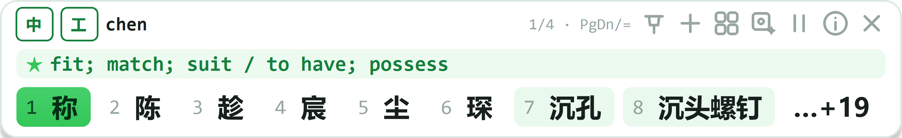

# RlonIME（智语）· 工程领域中文输入法与术语翻译助手

**一个真正接管键盘的输入法，不是弹窗工具。** 在任意 Windows 软件里敲拼音直接出专业术语候选；
选中中文按一次热键，就地替换成符合行业术语规范的英文。



---

## 它解决两个具体问题

**① 通用输入法打不出工程词。**
敲 `chenkong` 要翻三页才看到「沉孔」，`dangquan` 永远排在「当权」后面，
`gongsi` 的首选是「公司」而不是「攻丝」。RlonIME 用 15 个行业的术语库 +
8 万条通用词库做分层检索：**专业词精确命中优先，普通词回归输入法本色**。

**② 图纸和技术要求的中译英，术语前后不一致。**
同一份图纸里「倒角」一会儿 chamfer 一会儿 bevel，「沉孔」一会儿 counterbore
一会儿 counter sink。RlonIME 翻译时**锁定术语表**，译完再强制对齐一遍；
不满意的译法按 `Ctrl+Alt+W` 标记，下次同样的句子直接命中本机记忆库，不再走 AI。

---

## 两个维度的能力边界

### 一、作为输入法

| 能力 | 实现方式 |
|---|---|
| 全局接管 | `WH_KEYBOARD_LL` 低级键盘钩子，独立线程消息循环；钩子内只做判定，上屏入队由主线程执行 |
| 不抢焦点 | 候选条 `WS_EX_NOACTIVATE` 双保险（Qt 窗口标志 + Win32 扩展样式），焦点始终在目标程序 |
| 零剪贴板污染 | `SendInput` + `KEYEVENTF_UNICODE` 逐字上屏，不模拟 `Ctrl+V` |
| 浏览器 / Office / CAD / 自绘控件 | 只依赖系统键盘与插入符 API，不需要任何软件插件 |
| 多屏混合 DPI | 插入符坐标按「所在显示器的物理原点 + 缩放」换算，逐屏 `screenAt` 判定，不做主屏夹取 |
| 中文标点 | 8 个常用标点 + 书名号，引号成对翻转；CAD 直通与组合态有明确边界 |
| 中英切换 | 双击 `Shift`、`Ctrl+Space`、点候选条状态徽标，三种手势等价 |
| CapsLock | 大写锁定 = 英文直通（与系统输入法一致） |
| 组合态编辑键 | `← → Home End Delete`：先上屏当前词，再执行按键，**绝不把拼音原文吐进文档** |
| CAD 命令直通 | 前台是 AutoCAD / CAXA / ZWCAD 时字母默认放行；`Ctrl+Space` 只临时激活 5 秒 |
| 候选条操作 | 分页（`PgUp/PgDn`、`-` `=`、滚轮、点徽标）、数字键按本页序号选词、拖动固定、单击跟随 |

### 二、作为专业翻译工具

| 能力 | 说明 |
|---|---|
| 五级管线 | 记忆库精确 → 记忆库模糊 → 术语整段覆盖 → 大模型 → 免费在线，逐级降级 |
| 术语强制对齐 | 译文中必须出现标准译名；出现别名（bevel/chamfer）自动替换并标记「术语已校正」 |
| 英→中回译 | 术语反查 + 大模型，结果做**术语缺失检查**并如实提示（不硬替换，避免病句） |
| 无 Key 可用 | 没配 API Key 也能翻译：MyMemory → Google 免 Key 端点，同样过术语锁 |
| 记忆闭环 | AI 初稿低权重入库；用户改完标记后永久覆盖，同句不再走 AI |
| 结果可复制 | 单击结果正文复制全文（显示的是截断文本，复制的是完整译文） |
| 隐私 | 首次使用免费翻译会明确提示「文字会发到公开服务」，可在 Ⓐ 里关闭 |

---

## 快速开始

### 安装版

到 [Releases](../../releases) 下载 `RlonIME_Setup_v3.0.0.exe`，双击安装（per-user，**不需要管理员权限**）。

- 安装目录：`%LOCALAPPDATA%\Programs\ZhiyuIME`
- 用户数据：`%APPDATA%\ZhiyuIME`（卸载不删，词库与记忆库会保留）
- 开机自启：安装时可选，之后可在「Ⓘ 关于」里开关

### 源码运行

```bash
python -m venv .venv
.venv\Scripts\pip install -r requirements.txt
.venv\Scripts\python src\main.py
```

要求 Windows 10/11 x64 + Python 3.11+（开发环境为 3.13）。

---

## 快捷键

| 快捷键 | 作用 |
|---|---|
| 直接敲拼音 | 出候选；`空格`/`回车` 取首选（**只在精确命中时**，否则直出原文） |
| `1`–`9` `0` | 选本页第 N 个候选 |
| `Tab` | 上屏当前候选的英文 |
| `Ctrl` + 数字 | 上屏「中文 English (标准号)」 |
| `-` `=` / `PgUp` `PgDn` / 滚轮 | 候选翻页 |
| 双击 `Shift` / `Ctrl+Space` | 中英切换 |
| `Ctrl+Alt+Q` | 选中即译（中→英 / 英→中自动判方向） |
| `Ctrl+Alt+W` | 标记纠正：把「原文 + 你改好的译文」写进记忆库 |
| `Ctrl+Alt+E` | 显示/隐藏候选条 |
| `Ctrl+Alt+A` | 切换行业范围 |
| `Ctrl+Alt+S` | AI 增强开关 |

热键全部可在 `data/config.json` 的 `hotkeys` 段自定义。

---

## 项目结构

```
src/
  core/
    ime.py            # 键盘钩子 + 拼音状态机 + SendInput 上屏 + 插入符定位
    engine.py         # 分层检索与打分（专业词优先、通用词兜底、绝不伪造候选）
    lexicon.py        # 词库加载与倒排索引（全拼/简拼/中文/英文 + 通用词库 bisect）
    translate.py      # 五级翻译管线 + 术语锁 + 记忆库学习
    free_translate.py # 免 Key 在线翻译（MyMemory / Google），长句切段
    capture.py        # 取写层：剪贴板无损快照 + Ctrl+C 取词
    config.py         # 配置与默认值（版本号唯一来源）
  ui/
    bar.py            # 候选条（胶囊分页、译法列、联想、结果态、拖动/固定）
    dpi.py            # 混合 DPI 坐标换算（物理 → Qt 逻辑，逐屏配对）
    floatbtn.py       # 选区旁悬浮「译」钮（不装鼠标钩子）
  main.py             # 应用装配、托盘、热键分发、后台结果回收
data/
  lexicons/           # 15 个行业术语库
  common/             # 8 万条通用词库（gz，构建脚本可复现）
  phrases/            # 技术要求句库
packaging/
  build.py            # 一键构建（PyInstaller onedir + Inno Setup）
  zhiyu.spec          # 打包清单（裁剪 Qt 插件与 TLS 后端）
scripts/              # 16 套测试 + 构建期词库生成脚本
```

---

## 构建

```bash
python packaging/build.py              # 完整构建（exe + 安装包）
python packaging/build.py --skip-exe   # 只重打安装包
```

- 打包依赖：`pip install pyinstaller`、[Inno Setup 6](https://jrsoftware.org/isinfo.php)
- UPX（可选）：把 `upx.exe` 放到 `packaging/tools/upx/`。**不加 `--clean`**，
  每轮自动使用新的 `distN` 目录（源码里有防呆）
- 输出：`distN/ZhiyuIME/` 与 `distN/installer/RlonIME_Setup_vX.Y.Z.exe`

## 测试

```bash
# 纯逻辑（不需要真实桌面）
python scripts/test_ime.py            # 输入内核 126 条
python scripts/test_leak.py           # 检索不漏词 / 不伪造 61 条
python scripts/test_common.py         # 通用词库手感 72 条
python scripts/test_free_translate.py
python scripts/test_cad_passthrough.py
python scripts/test_ime_ui.py         # 候选条接线（v3.0 新增）

# 需要真实桌面（会弹窗、抢焦点）
python scripts/test_ime_e2e.py
python scripts/test_ime_live.py       # 整机联调；ZHIYU_TARGET=<exe> 可验安装版
python scripts/smoke_ui_v22.py
python scripts/smoke_tray.py
```

合计 **600+ 条断言**。`test_ime_live` 的失败大多是第三方窗口抢前台导致的假失败，
判据是失败信息里的 `fg hwnd` 属于别的进程；桌面安静时重跑即过。

---

## 设计红线（改代码前必读）

1. **候选窗永不抢焦点。** 一旦抢焦点，`SendInput` 会打到输入法自己身上。
2. **钩子回调内不阻塞。** 不查进程、不读文件、不调重 API，一律主线程轮询。
3. **吞了 keydown 必须配套吞 keyup。** 否则目标程序键盘状态机错乱，注入字符会被丢弃。
4. **绝不伪造候选。** 候选池必须由输入本身决定；任何"按领域高频补足"都会让同一输入恒定产出无关词。
5. **专业词优先，但不许污染普通输入。** 前缀命中不吃领域加权，1–2 字母英文别名零加权。
6. **改检索必跑 `test_leak`**（同源不变式 + 300 次随机乱敲，无关候选必须为 0）。

## 已知限制

- 仅支持 Windows 10/11 x64；不支持 ARM64 与精简版系统。
- 全局键盘钩子可能被部分反作弊 / 安全软件拦截；以管理员权限运行的窗口默认无法注入。
- 免费翻译会把选中文本发往公共接口，保密场景请关闭（Ⓐ → 免费翻译）或只用本地 + 私有模型。
- 术语库聚焦工程与职能场景（15 个行业、约 2000 条精编术语），不是通用大词库。

### 网络受限（WinError 10013 / 18013）怎么办

企业网络、防火墙或代理软件的规则可能**禁止程序直连外网**，此时免费翻译与 AI 会报：

```
以一种访问权限不允许的方式做了一个访问套接字的尝试
```

RlonIME 会自动尝试环境变量、系统代理设置与常见本地代理端口（7890/7897/10809…）。
如果仍不通，在 **Ⓐ → 代理** 里填本机代理地址（如 `127.0.0.1:7890`）即可，AI 与免费翻译共用。
没有代理也不打算配 AI Key 时，把 Ⓐ 里的「没有 Key 时用免费在线翻译」关掉，软件会退回纯本地
词库 + 记忆库，仍然可用。

## 许可

[MIT](LICENSE)。行业词库与句库为本项目整理，通用词库由 CC-CEDICT 与 jieba 词频构建。
