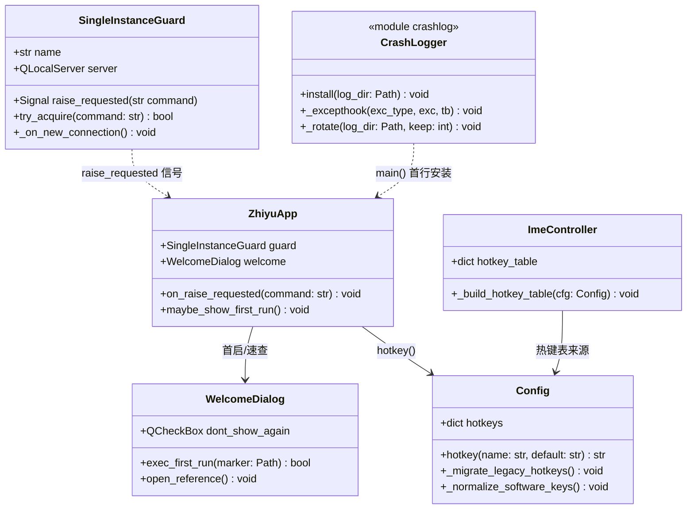
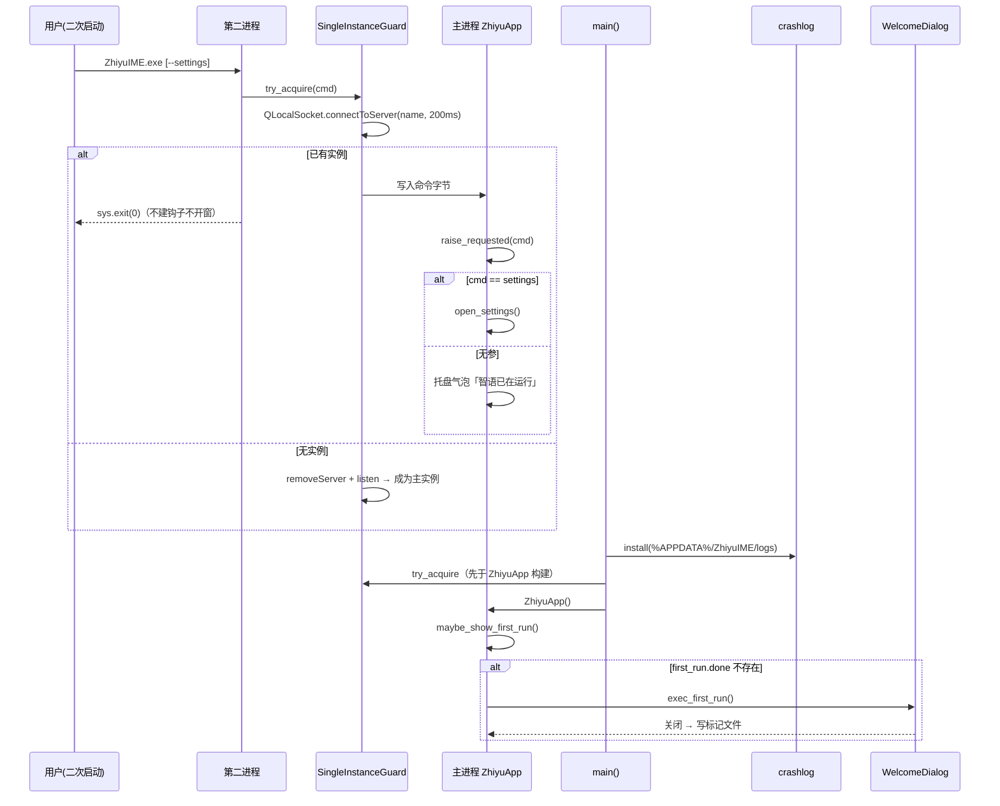

# 智语输入法 v2.0.0 · 增量架构设计与任务分解

- 架构师：高见远（Gao）
- 日期：2026-10-08
- 输入：docs/audit_2026-10-08.md（PM 审核报告）、README.md、src/main.py、packaging/installer.iss、data/config.json、packaging/zhiyu.spec（均已实读验证）
- 冲刺范围：P0-3 → P0-2 → P1-1/P1-4/P1-5 → P0-1，并入 P2-2/P2-3/P2-4

---

## 一、实现方案

### 1.1 PySide6 迁移（P0-2）

**已 grep 实证**（`pyqtSignal|pyqtSlot|exec_|PyQt6|QAction`），迁移面如下：

| 类别 | 现状 | 迁移动作 |
|---|---|---|
| 模块导入 | 6 个 src 文件：`main.py:35-37`、`core/capture.py:81/118/138`、`ui/bar.py:30-36`、`ui/icons.py:17-18/346`、`ui/panel.py:35-39`、`ui/settings.py:16-18/32-33/684` | `PyQt6` → `PySide6`，逐文件替换 |
| 信号 | `pyqtSignal` 11 处（main.py 2、bar.py 6、panel.py 4、settings.py 1） | `pyqtSignal` → `Signal` |
| `pyqtSlot` | **0 处**（实证） | 无需处理 |
| `exec_()` | **0 处**，仅 `app.exec()`（main.py:464） | 无需处理（PySide6 同名） |
| `QAction` 归属 | main.py:36 已从 `QtGui` 导入 | PySide6 中 QAction 同在 QtGui，**无需改** |
| 枚举访问 | 代码已全用全限定枚举（`Qt.PenStyle.NoPen` 等） | 兼容，无需改 |
| 测试脚本 | 7 个 scripts 文件命中 PyQt6：gui_test / smoke_test / shoot_panel / test_assist / test_assist_live / test_ime_e2e / test_ime_live | 同样替换（工程师迁移后再次 grep 归零复核） |

**依赖与打包：**
- `requirements.txt`：`PyQt6>=6.6.0` → `PySide6>=6.7.0,<7.0.0`（锁定大版本，避免 Qt 7 API 漂移）。
- `packaging/zhiyu.spec` excludes 段：13 项 `PyQt6.*` 全部改为 `PySide6.*` 对应子模块，并**追加** `"PyQt6"`、`"PyQt5"`、`"PySide2"` 到 excludes，防环境残留被打进产物；新增排除 `PySide6.QtWebEngineCore` 等同名重模块已在映射内。注意 **不要** 排除 `PySide6.QtNetwork`（单实例 QLocalServer 需要）。
- `packaging/license.txt`：GPL 处置段改写为 PySide6 (LGPL v3) 合规说明：Qt 以动态链接（onedir 下 DLL 独立）分发，满足 LGPL relink 条款；保留第三方许可清单。
- **回归网**：迁移完成后六套测试（test_ime / test_ime_e2e / test_ime_live / test_assist / test_assist_live / test_leak）必须全绿，再进下一任务。迁移是纯重命名，任何测试失败即迁移遗漏，不允许"顺手改行为"。

### 1.2 单实例防护（P0-3）

Qt 原生 `QLocalServer`/`QLocalSocket`（QtNetwork），不引新依赖。

- 新建 `src/core/single_instance.py`：`SingleInstanceGuard`
  - 服务名：`"ZhiyuIME-SingleInstance-" + 当前用户名`（Windows 上 named pipe 默认按会话隔离，加用户名后缀防多用户/RDP 冲突）。
  - `try_acquire() -> bool`：先以 QLocalSocket 连接，200ms 内连上 → 写入一字节命令（`b"raise"` 或 `b"settings"`）→ flush → 返回 False（调用方立即 `sys.exit(0)`）；连不上 → `QLocalServer.removeServer(name)` 清残留（崩溃后 stale socket）→ `listen(name)` → 返回 True。
  - 监听端 `newConnection` → 读取命令 → 发 Qt 信号 `raise_requested(str)` 到主线程。
- `main.py::main()` 集成顺序：`bootstrap()` → `QApplication` → **`try_acquire`，失败即退** → 其余初始化（放在 ZhiyuApp 构建之前，避免第二个进程也挂键盘钩子）。
- 二次启动行为：
  - 无参启动 → 已有实例托盘气泡「智语已在运行」+ 托盘图标闪烁（`QSystemTrayIcon.showMessage` 即可，不弹窗打扰）；
  - `--settings` 启动 → 已有实例直接唤起设置中心（`open_settings()`）。这条与 installer.iss:65 的「设置中心」快捷方式语义一致。
- **双入口验证方案**（写进测试）：
  - 自动化：新建 `scripts/test_single_instance.py`——起进程 A，起进程 B，断言 B 在 3s 内退出、A 存活且收到 raise（A 侧用 `--selftest-raise-flag <path>` 测试开关，收到唤起后写标志文件）。
  - 手工（安装版，T05 执行）：勾选「开机自动启动」装好后，注销重登（或直接运行注册表 Run 项里的命令）→ 再双击桌面图标 → `tasklist | findstr ZhiyuIME` 仅 1 个进程，托盘弹「已在运行」。

### 1.3 Inno 向导中文（P1-1）

- 语言文件来源（按优先级）：① 本机 Inno 6 安装目录 `Languages\ChineseSimplified.isl`（Inno Setup 6 官方自带，先验证存在）；② 缺失则从官方仓库 jrsoftware/issrc 的 Files/Languages 下载同名文件。
- 落盘 `packaging/ChineseSimplified.isl`（随仓库管理，保证可复现编译）。
- `installer.iss`：`[Languages]` 改为 `Name: "chs"; MessagesFile: "ChineseSimplified.isl"`，删除 53-54 行旧配置与 48-51 行说明注释。
- 重编译验证：向导按钮显示「下一步(N)/安装(I)/完成(F)」；[Tasks]、[Run] 段中文字符串不受影响；授权页 license.txt 正常渲染（UTF-8）。

### 1.4 首启引导（P1-4）

- 新建 `src/ui/onboarding.py`：`WelcomeDialog(QDialog)`，一页图文（不做多页向导，最小实现）：上方标题 + 三张已有截图轮播/并列（`docs/bar_input.png`、`bar_result.png`、`bar_hint.png` 复制为 `data/guide/*.png`，随 spec datas 打包）+ 三条核心快捷键文案（Ctrl+Space / Ctrl+Alt+T / Ctrl+Alt+M）+「不再显示」勾选 +「开始使用」按钮。
- 首启标记：`%APPDATA%\ZhiyuIME\first_run.done`（空文件即标记；放用户目录而非安装目录，卸载不删，重装不重复弹）。判断与写入走 `core/paths.py` 的 `user_data_root()`。
- `main.py`：`ZhiyuApp` 构建后判断标记不存在 → 弹 WelcomeDialog（模态，关闭后写标记）。托盘菜单在「设置中心…」前加「快捷键速查…」，随时重开同一对话框（重开不写标记逻辑）。
- 截图复用 `docs/bar_*.png` 是本轮方案；后续候选条 UI 改版时需同步更新 `data/guide/`（列为维护项）。

### 1.5 热键收敛（P1-5）

实证比审核报告更严重：`hotkeys` 段（config.json:517-523）在代码里**只被 config.py:97 加载、无任何消费方**；`assist` 段的 `translate_hotkey`/`mark_hotkey`（563-571）同样无人读；真正生效的是 `ime.py:144-145` 的硬编码 VK 表和 `main.py:478-482` 的硬编码兜底。方案：

- **单一来源 = `hotkeys` 段**（5 项：translate_selection / mark_correction / toggle_panel / cycle_scope / toggle_llm）。
- `core/config.py` 新增访问器 `hotkey(name: str, default: str) -> str`：优先读 `hotkeys` 段；兼容读取旧 `assist.translate_hotkey`/`mark_hotkey`（老配置升级不丢自定义），命中旧键时一次性迁移写回 `hotkeys` 段并删除旧键。
- `core/ime.py`：启动时把热键串（`"ctrl+alt+t"` 格式）解析为 (修饰键集合, VK) 构建热键表，替换 144-145 行硬编码；解析失败回退内置默认并 warn。解析器只支持 `ctrl/alt/shift/win + 单字符`，与现有 `_VK_*` 常量复用。
- `main.py` 兜底热键（478-482）与托盘菜单快捷键文案（262-284）改从 `config.hotkey()` 取，不再硬编码。
- `ui/settings.py`：热键相关设置统一写回 `hotkeys` 段。
- `data/config.json`：删除 `assist.translate_hotkey`/`mark_hotkey` 两行（新装即单一来源）。

### 1.6 崩溃日志（P2-2）

- 新建 `src/core/crashlog.py`：`install(log_dir)` —— `sys.excepthook` + `threading.excepthook` + `faulthandler.enable()` 三件套，异常落 `%APPDATA%\ZhiyuIME\logs\crash-YYYYMMDD-HHMMSS.log`（含版本、Python/OS 信息、堆栈；**不含任何按键内容与用户文本**，守隐私红线）；保留最近 20 份滚动清理；只本地、零网络。
- `main.py::main()` 第一行（`bootstrap()` 之后、QApplication 之前）调用。Qt 事件循环内的未捕获异常经 excepthook 落盘后**保持进程存活**（托盘程序不因单个槽函数异常退出，写日志 + 托盘 hint 即可）。

### 1.7 配置拼写与尺寸口径（P2-3 / P2-4）

- `data/config.json:216` `"epaln"` → `"eplan"`；`core/config.py` 加载 softwares 时做旧键映射（`epaln` → `eplan`），老配置兼容。
- 尺寸口径统一为 **560×36**（bar.py 实际值）：README.md:26（640×36 → 改）、src/main.py:21 docstring（520×36 → 改）、bar.py 头注释（已是 560，不动）。顺手核对 README 其余 640 字样。

### 1.8 词库扩容技术路线（P1-3，本轮只出规范，不实施）

- **数据规范**：`data/lexicons/<industry>.json` 每条必须含 `zh`（中文）、`en`（英文标准译名）、`std`（标准号，可空）；拼音缓存由构建期 pypinyin 生成，运行期不现算；同行业内 `zh` 唯一，`zh+en` 组合全局去重；单条 zh 长度 2–20 字。
- **验收标准**：每行业 ≥150 条；新增 `scripts/validate_lexicon.py`（规范校验器：字段完整、去重、拼音可生成、JSON 合法），进 CI 式手跑清单；交付前 `test_ime` / `test_assist` 全绿。
- **性能联动**：`engine.search` 当前逐键全量前缀扫描（engine.py:130-142），~1600 条无压力；**触发换索引的阈值：总词条 >8000 或新增基准脚本实测单键检索 >5ms**。届时改「首 1–2 个拼音字母分桶 + 桶内前缀匹配」（不引 trie 库，字典分桶即可，改动集中在 engine.py 一个文件）。本轮先落 `scripts/bench_search.py`（基准，50 键随机拼音计时）作为观察哨——该脚本随 T03 交付，成本极低。

### 1.9 代码签名技术路线（P1-2，不进代码冲刺）

- 采购 OV 代码签名证书（采购周期 1–3 周，主理人启动采购即并行）。
- 证书到位后（后续冲刺）：① `signtool sign /fd SHA256 /tr <timestamp> ZhiyuIME.exe`（PyInstaller 产物先签）；② installer.iss 加 `SignTool=` 段，ISCC 编译时签 setup.exe；③ 验收 = 全新 Win11 机器 SmartScreen 无红屏。触发时机：证书到货当周。

---

## 二、文件清单（相对路径）

**新建：**
| 文件 | 用途 | 所属任务 |
|---|---|---|
| src/core/single_instance.py | QLocalServer 单实例防护 | T02 |
| src/core/crashlog.py | 崩溃日志（excepthook/faulthandler） | T02 |
| src/ui/onboarding.py | 首启引导对话框（兼托盘「快捷键速查」） | T04 |
| scripts/test_single_instance.py | 单实例自动化测试 | T02 |
| scripts/bench_search.py | 检索性能基准哨兵 | T03 |
| data/guide/bar_input.png 等 3 张 | 引导页截图（复制自 docs/） | T04 |
| packaging/ChineseSimplified.isl | Inno 中文语言包 | T04 |

**修改：**
| 文件 | 改动 | 所属任务 |
|---|---|---|
| requirements.txt | PyQt6→PySide6 | T01 |
| packaging/zhiyu.spec | excludes 映射 PySide6 + 排除 PyQt 全家 + datas 加 guide | T01（guide 部分 T04） |
| packaging/license.txt | GPL→LGPL 合规口径 | T01 |
| src/main.py | import 迁移(T01) → 单实例+崩溃日志接入(T02) → 热键访问器+docstring 口径(T03) → 首启判断+托盘菜单(T04) | T01–T04 |
| src/core/capture.py、src/ui/bar.py、src/ui/icons.py、src/ui/panel.py、src/ui/settings.py | import 迁移 | T01 |
| scripts/gui_test.py 等 7 个命中文件 | import 迁移 | T01 |
| data/config.json | 删 assist 热键旧键、epaln→eplan | T03 |
| src/core/config.py | `hotkey()` 访问器 + 旧键兼容迁移 + softwares 旧键映射 | T03 |
| src/core/ime.py | 热键表由配置解析构建（替换 144-145 硬编码） | T03 |
| src/ui/settings.py | 热键写回 hotkeys 段 | T03 |
| README.md | 尺寸口径 560×36、PySide6 口径 | T03 |
| packaging/installer.iss | MessagesFile 中文 | T04 |

---

## 三、关键接口与数据结构

## 四、关键调用流

---

## 五、任务列表（按实现顺序）

| Task | 名称 | 依赖 | 优先级 |
|---|---|---|---|
| T01 | 基础设施与 PySide6 迁移（P0-2） | — | P0 |
| T02 | 单实例防护 + 崩溃日志（P0-3 / P2-2） | T01 | P0 |
| T03 | 热键收敛 + 配置修正 + 性能哨兵（P1-5 / P2-3 / P2-4） | T01 | P1 |
| T04 | 首启引导 + 安装向导中文（P1-4 / P1-1） | T01 | P1 |
| T05 | 重打包 + 安装版全量复测（P0-1） | T02, T03, T04 | P0 |

> 主理人定的顺序是 P0-3 先于 P0-2；但单实例代码落在 main.py，若在 PyQt6 下写、T01 又得返工同一文件。经权衡改为 **T01 迁移先行**（纯重命名、风险最低、测试网现成），T02 直接在 PySide6 上一次写对。总量不变。若主理人坚持原顺序，T02 可在 PyQt6 下先行、T01 跟随改 import，两任务互换位置即可，无技术阻塞。

**T01 基础设施与 PySide6 迁移（P0-2）**
- 文件：requirements.txt、packaging/zhiyu.spec、packaging/license.txt、src/main.py、src/core/capture.py、src/ui/bar.py、src/ui/icons.py、src/ui/panel.py、src/ui/settings.py、scripts/ 下 grep 命中的 7 个测试/工具脚本
- 做什么：按 §1.1 表执行纯重命名迁移；spec excludes 全量映射并追加 PyQt6/PyQt5/PySide2；license.txt 改 LGPL 口径
- 验证：`pip install -r requirements.txt` 后六套测试全绿；`grep -ri "pyqt" src/ scripts/ requirements.txt packaging/zhiyu.spec` 归零（license.txt 历史说明除外）；源码态冷启动托盘正常、候选条三形态截图（--shot）与基线一致

**T02 单实例防护 + 崩溃日志（P0-3 / P2-2）**
- 文件：新建 src/core/single_instance.py、src/core/crashlog.py、scripts/test_single_instance.py；修改 src/main.py
- 做什么：按 §1.2 / §1.6 实现；`main()` 顺序 = bootstrap → crashlog.install → QApplication → try_acquire（失败即退）→ ZhiyuApp
- 验证：`python scripts/test_single_instance.py` 通过（双开 B 进程 3s 内退出、A 收 raise 写标志）；手工 `--settings` 双开唤起设置中心；人为在槽函数里 `raise` 验证 crash 日志落盘且进程存活；六套测试回归全绿

**T03 热键收敛 + 配置修正（P1-5 / P2-3 / P2-4）**
- 文件：data/config.json、src/core/config.py、src/core/ime.py、src/main.py（fallback 热键 + 托盘文案 + docstring）、src/ui/settings.py、README.md；新建 scripts/bench_search.py
- 做什么：按 §1.5 / §1.7；`config.hotkey()` 单一来源 + 旧键兼容迁移；ime.py 热键表配置化（解析失败回退默认）
- 验证：六套测试全绿（重点 test_ime 的 Ctrl+Alt+T/M 用例）；手测改 config.json 热键为 ctrl+alt+y 后选中即译生效；旧配置（含 assist.translate_hotkey）启动后自动迁移；README/main.py/bar.py 三处尺寸口径 grep 一致（560×36）

**T04 首启引导 + 向导中文（P1-4 / P1-1）**
- 文件：新建 src/ui/onboarding.py、data/guide/*.png（3 张，复制自 docs/）；修改 src/main.py、packaging/zhiyu.spec（datas 加 guide）、packaging/installer.iss；落盘 packaging/ChineseSimplified.isl
- 做什么：按 §1.3 / §1.4
- 验证：删 `%APPDATA%\ZhiyuIME\first_run.done` 重启弹引导、勾选「不再显示」后不复弹；托盘「快捷键速查…」随时可开；ISCC 重编译后向导按钮全中文、安装流程走通

**T05 重打包 + 安装版复测（P0-1）**
- 文件：dist9x/ 产物、packaging/installer.iss（如有版本口径微调）
- 做什么：PyInstaller 重打包 → ISCC 重编译 → 安装到干净目录 → 按 README 流程对 exe 跑 `ZHIYU_TARGET=... test_ime_live / test_assist_live / test_leak`；执行 §1.2 双入口手工验证
- 验证：三套 live 测试对 exe 全绿；安装产物不含 PyQt6 痕迹（`grep -ri pyqt dist9x/ZhiyuIME/` 归零）；自启+桌面图标双入口单实例实测通过；首启引导在安装版首跑弹出

---

## 六、共享约定（工程师必读）

- Qt 导入统一 `from PySide6.QtCore/QtGui/QtWidgets/QtNetwork import ...`；信号用 `Signal`；**禁止引入 PyQt6 字样**（迁移后 grep 归零是验收项）。
- 用户可写数据一律走 `core/paths.py::user_data_root()`（%APPDATA%\ZhiyuIME）；安装目录只读资源不写入。
- 热键唯一来源：`config.hotkey(name, default)`；任何模块不得自带热键字符串硬编码（内置默认值只允许出现在 config.py 的 default 参数里）。
- 崩溃日志只本地不上传；日志不得包含按键内容、剪贴板内容、用户选区文本。
- 红线复述（不可触碰）：候选条 `WS_EX_NOACTIVATE` 三重保障不动；上屏只用 SendInput Unicode；绝不伪造候选；`SetWindowsHookEx` hMod=NULL；钩子回调不阻塞、上屏 25ms 轮询消费不动。
- 不引新重依赖：单实例/崩溃日志/引导页全部 Qt 原生 + 标准库。
- 每个任务完成后必须跑六套测试全绿才准提下一任务（迁移类改动尤其）。

## 七、风险与待确认

1. **PySide6 版本**：建议锁 `>=6.7.0,<7.0.0`；若构建机已装其他版本，以六套测试全绿为准，必要时放宽下限到 6.6。
2. **ChineseSimplified.isl 来源**：假设本机 Inno 6 自带（T04 第一步验证）；若缺，从 Inno 官方仓库下载，需主理人确认网络可达。
3. **QLocalServer 多会话**：named pipe 按会话隔离 + 用户名后缀已规避；RDP 多会话场景未实测，列入 T05 手工验证观察项。
4. **PySide6 LGPL 细节**：onedir 动态链接满足 relink；若未来改 onefile/静态化需重新评估（当前无此计划）。
5. **首启截图时效**：`docs/bar_*.png` 为当前 UI 截图，候选条改版后需同步更新 `data/guide/`（维护项）。
6. **任务顺序调整**：我把主理人定的 P0-3→P0-2 调整为 T01 迁移先行（理由见任务表下注释），请主理人确认。
7. **词库扩容与代码签名**：本轮只出路线（§1.8/§1.9），触发时机分别为主理人立项扩容、证书到货。
