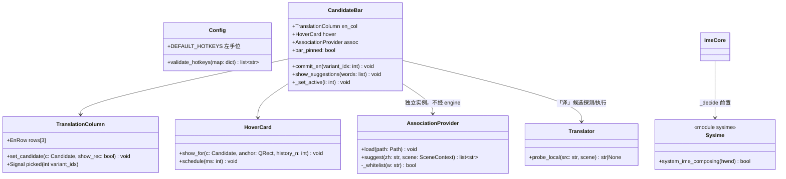
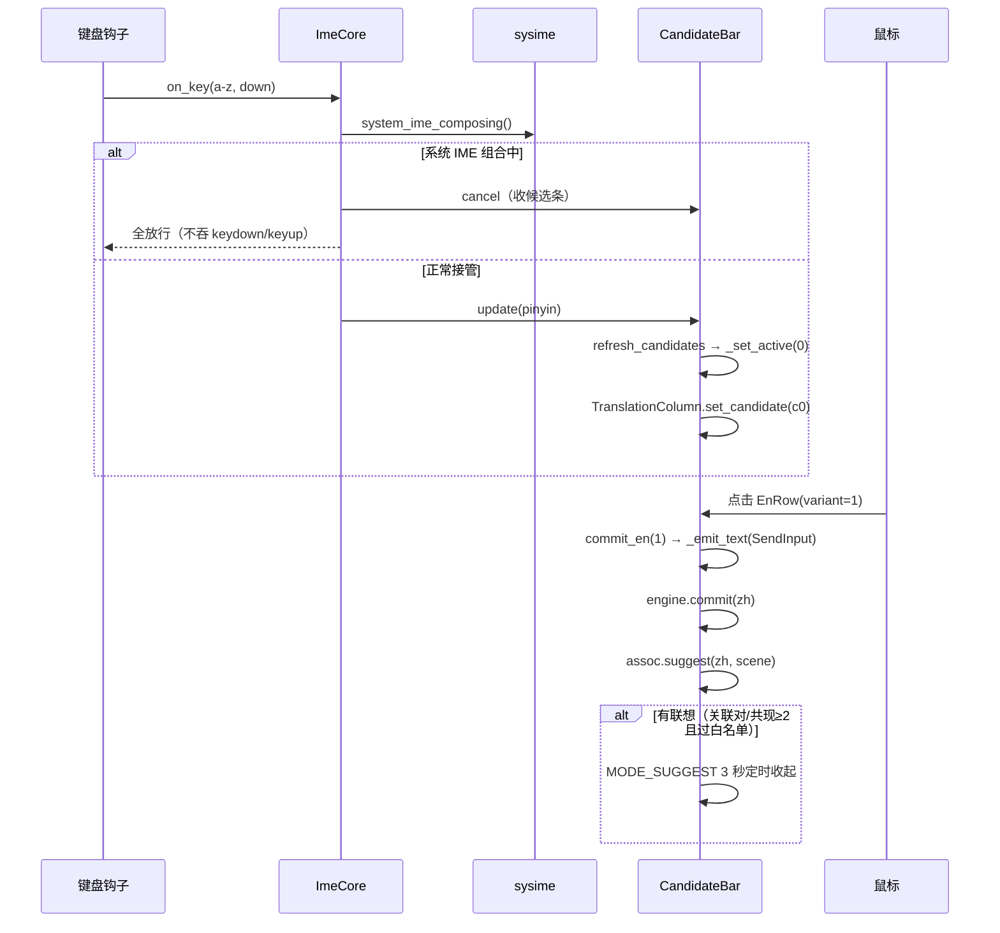

# 智语 v2.1 · 交互重设计架构设计与任务分解

- 架构师：高见远（Gao） · 日期：2026-10-08
- 输入：docs/prd_ux_2026-10-08.md（PM 增量 PRD）+ 主理人对 Q1–Q5 的裁决
- 代码基线已实读验证：bar.py / design.py / engine.py / config.py / ime.py / models.py / main.py / lexicon.py
- 裁决落实：Q1 P2 只出路线；Q2 无译法不出候选+提示；Q3 拖动位置全局一份；Q4 基于 PySide6 6.11.2 直接写；Q5 联想仅有关联对或同场景共现≥2 词时触发

---

## 一、实现方案（按 PRD 需求池）

### 1.1 UX-P0-1/2 候选条布局重做（bar.py 主体改造）

**新结构**（纵向三段，卡片总高自适应，替代现单行 36px 布局）：

```
┌ card ─────────────────────────────────────┐
│ [把手 ⠿] [拼音 lead]      [modeHint] [⚙]  │ 顶行（兼拖动把手区）
│ ┌ 译法列 TranslationColumn（池化 3 行）───┐ │
│ │ ★ Counterbore · GB/T 152.2  [推荐]      │ │ ← 当前选中项译法，高亮
│ │   Spotface                              │ │ ← var_en 次译法
│ └─────────────────────────────────────────┘ │
│ [1 沉孔] [2 埋头孔] [3 螺纹孔] [4 锪平]      │ 中文胶囊行（现有 Chip 池复用）
└─────────────────────────────────────────────┘
```

- **译法列 `TranslationColumn`**：池化 3 个 `EnRow` 自绘控件（与 Chip 同套池化哲学，刷新只改文字）。数据源 = `candidates[active_index]`：`term.en`（首行，含 `standard`）+ `term.var_en`（次译法，最多 2 行）。无英文的候选 → 整列隐藏（中文-only 词不造译法，守不伪造红线）。
- **点击上屏（UX-P0-2 修复）**：`EnRow.picked(variant_idx)` → `CandidateBar.commit_en(variant_idx)`：取该译法文本（**不含标准号**，标准号保留给 Tab/Ctrl+数字组合路径），走 `_emit_text()`（SendInput，不变），`engine.commit(zh)` 记历史。现状 preview 是 QLabel 无点击通道，此为 Bug 根因，本轮整区换自绘控件一并修复。
- **选中联动**：`move_active`/`page_move`/`_on_chip_picked` 收口到 `_set_active(i)` 单点，内部统一刷新译法列（现状散在三处各自 `_relayout`）。
- **「推荐」标**：`candidates[0].score - candidates[1].score > config.ranking.rec_badge_margin`（新增字段，默认 8.0）才显示；仅候选 ≥2 条时参与判断。徽标画在译法列首行右侧。
- 图标精简：删除 `lead_icon` 键盘图标与 `tail` 页码外的冗余，仅留 ⚙。
- 红线保持：`prime_window`/`make_no_activate` 不动；三段布局都在同一 card 内，窗口级属性不变。

### 1.2 UX-P0-3 系统 IME 冲突规避（新建 core/sysime.py + ime.py 放行）

- 新建 `src/core/sysime.py`：`system_ime_composing(hwnd=None) -> bool`，纯 ctypes 调 imm32（标准库，无新依赖）：
  1. `ImmGetDefaultIMEWnd(GetForegroundWindow())` → IME 窗口句柄；
  2. 主判据：`ImmGetContext(foreground) + ImmGetCompositionStringW(hIMC, GCS_COMPSTR)` 非空 → 组合中；
  3. 兜底判据（TSF 输入法 IMM32 兼容失败的保险）：枚举顶层窗找类名含 `"ime"`/`"Candidate"` 的可见窗口（系统 IME 候选窗可见即视为组合态）；
  4. 任一命中即 True；异常一律返回 False（宁可放行智语，不制造新吞键事故）。
- `ime.py::ImeCore._decide()` 最前插入：接管态且 `system_ime_composing()` → `reset()`（发 cancel 收候选条）+ **全放行**（吞 keydown 配套吞 keyup 的状态机不参与，因为压根不吞）。调用点只在 a–z/数字等可吞键的 keydown 路径，imm32 调用为微秒级，不违钩子不阻塞红线。
- **托盘「暂停接管」**：复用现有 `act_ime`（接管键盘输入，Ctrl+Space），改名「暂停接管/恢复接管」语义并加状态文案；自动放行是瞬态（不改 `enabled`），与用户暂停（`set_enabled(False)`)是两条独立路径，托盘 tooltip 显示「自动放行中（系统输入法组合中）」。
- 测试：test_ime 新增 mock 用例（monkeypatch `system_ime_composing` → True 时任何按键不吞）；test_ime_live 增加手工项：系统拼音打字时智语不出候选。

### 1.3 UX-P0-4 字号令牌

- `design.py::_Base`：`FS_ZH 13→12`、`FS_EN 11→10`（新装默认值）。
- `config.py::UIConfig` 新增 `font_size_zh: int = 12`、`font_size_en: int = 10`；`data/config.json` ui 段同步。bar.py 字体构建改读 config（覆盖 DS 默认），设置中心改动 → 持久化 + `bar.reload_hierarchy()` 即时生效（现有链路复用）。

### 1.4 UX-P0-5 左手热键默认值 + 冲突校验

- `config.py::DEFAULT_HOTKEYS`：translate_selection `ctrl+alt+q` / mark_correction `ctrl+alt+w` / toggle_panel `ctrl+alt+e` / cycle_scope `ctrl+alt+a` / toggle_llm `ctrl+alt+s`；`data/config.json` hotkeys 段同步（老用户已持久化的自定义不受影响——配置值优先于默认值，现有 `hotkey()` 语义天然兼容）。
- `parse_hotkey` 已支持字母/数字，q/w/e/a/s 无需改内核。
- **设置中心冲突校验**（随 T05 落地）：保存前校验 ① 五键互不相同；② 不与 `ime.toggle_hotkey`（ctrl+space）相同；③ `parse_hotkey` 可解析；冲突则红字提示且禁止保存。校验函数 `validate_hotkeys(map) -> list[str]` 放 config.py，设置中心与单测共用。

### 1.5 UX-P0-6 隐藏「指定工作软件」

- main.py：删除托盘 `sw_menu`、`act_auto`（恢复自动识别）两个菜单入口及 `_rebuild_sw_menu`；`switch_software`/`cycle_software` 方法一并删除（已无调用方）。
- settings.py（T05 重写）不出现该入口。
- `scene/detector.py` 自动检测与加权**一行不动**。

### 1.6 UX-P0-7 精确命中降噪（engine.py）

两处改动，全部在 `search()` 现有结构内：
1. **前缀分硬约束**：`exact_hit == True` 时，prefix 路 `score = min(score, 79.0)`（精确档 100 的一档之下，且压过简拼 75 仅一线），同时 prefix 召回上限 `limit*3 → limit`。
2. **跨行业硬过滤**：`exact_hit == True` 时，领域过滤段改为硬剔除 `t.profession not in (active, "")` 的候选（现有 `score >= 60` 逃逸口在精确命中时关闭）；无精确命中时维持现状（跨行业高分词仍可见，保召回）。
- test_leak 新增用例：① `chenkong`（精确命中沉孔）时跨行业词（如包装行业同音词）不得入列；② 精确命中时前缀噪声词分低于精确词；③ 既有 43 项全绿回归。

### 1.7 UX-P1-1 拖动把手 + 偏移持久化

- 把手区 = 顶行左端 ⠿ 图标 + 拼音区空白（`DragHandle` 自绘控件）。`mousePressEvent` 记起点、`mouseMoveEvent` 整窗 `move()`——**无需激活窗口**，NOACTIVATE 窗口照常收鼠标事件，红线不破。
- 持久化（Q3 裁决：全局一份）：拖动结束写 `ui.bar_pinned: true` + `ui.bar_pos: [x, y]` 到 config.json（复用 main.py `_persist` 通道）；`follow_caret()` 前判断 pinned → 用持久化位置替代插入符跟随。
- 双击把手：`bar_pinned=false` 写回，立即恢复跟随。设置中心「输入」卡提供「候选条跟随光标」开关（同一字段）。

### 1.8 UX-P1-2 联想槽位（新建 core/assoc.py + data/associations.json）

- **数据**：`data/associations.json`：`{"pairs": {"沉孔": ["通孔", "平孔"], ...}}`，人工维护；随 spec datas 打包（zhiyu.spec datas 追加）。
- **`AssociationProvider`**（core/assoc.py）：
  - `suggest(zh, scene) -> list[str]`：① 关联对直查；② 同场景共现：与 zh 共享 ≥2 个 scene_tags、同行业、按 freq 排序补足（Q5 裁决：两路均无结果则不触发）；
  - **白名单校验**：返回词必须 `lexicons.find_by_zh(w)` 非空（词库中真实存在），否则丢弃——联想词上屏时等价于一次正常候选上屏，数据同源可查；
  - 与 `engine.search` **零共享**：独立文件、独立索引、独立实例；`TermEngine` 不 import assoc。
- **渲染**：bar 新增 `MODE_SUGGEST` 第四态：上屏成功后若有联想 → 显示 `沉孔 ✓ 联想→ [通孔] [平孔]`（独立 `SugChip` 池，最多 4 枚）；3 秒 `_hide_timer` 收起；Esc 关闭；点击/数字键上屏该词（走 `_emit_text` + `engine.commit`）。
- test_leak 新增隔离用例：上屏某词后联想槽出现 → 断言 `engine.search(任意输入)` 结果集不含联想词（除非该词本身能由输入命中）；关联对里放白名单外的词 → 断言被丢弃。

### 1.9 UX-P1-3 词库外「译」候选

- **触发**：`query 含中文 && engine.search 为空`（词库无命中）。候选 = 特殊条目 `译 <译文预览> →`，不占数字序号位（固定排在第 1 候选之后/无候选时独占）。
- **能力探测（Q2 裁决落地）**：构建候选时同步探测：
  - AI 开（`llm.available && enabled`）→ 出现，点击走 `translator.translate_async`，结果 SendInput 上屏 + `memory.learn`（store_llm_draft 沿用）；
  - AI 关 → `Translator.probe_local(src, scene) -> str | None`（新增轻量方法：记忆库精确/模糊 + 术语覆盖拼接的**只读预检**，返回可得译文或 None）；有结果 → 出现，点击同步上屏；无结果 → **候选不出现**，modeHint 显示「无译法 · 可开 AI」（不伪造）。
- **待确认**：当前内核只接 a–z 拼音，中文 query 无输入通道。本轮按「query 含中文」接口先行实现（engine 已支持中文 query），中文直输通道是否本轮开放需主理人/PM 裁决（见 §六）。

### 1.10 UX-P1-4 悬停说明卡（新建 ui/hovercard.py）

- `HoverCard`：无边框 frameless 小窗，同样过 `make_no_activate`（红线一致）；Chip `enterEvent` 启 400ms single-shot 定时器 → 弹出；`leaveEvent`/候选刷新/收条 → 立即关闭。
- 内容：`zh` + `en`（含 standard）+ `term.brief` + 推荐理由：复用 `Candidate.why()` 并扩展打分来源明细（`detail` 的 scene/history/freq 非零项逐行列出，如「场景=工程图标注 · 最近用过 3 次」——history 次数从 `engine.usage.count_of` 取）。

### 1.11 UX-P1-5 英文反查置主位

- engine.py：en 路命中时若**拼音全拼/简拼均无精确命中** → en 候选 `base 70→96`（压过前缀档），match_type 保持 `"en"`；有拼音精确命中时维持 70（英文只是辅助信息）。
- 上屏路径不变（中文胶囊点击/空格 = 中文上屏，已存在）。test_ime 新增：`counter` → 沉孔居首。

### 1.12 UX-P1-6 设置中心 MD3 重写（settings.py 整文件重写）

- 四组卡片：行业身份（三级细分选择，现有 hierarchy 逻辑复用）/ 输入（字号两个下拉、跟随光标开关、记住拖动位置开关）/ 快捷键（五行改键 + §1.4 冲突校验）/ AI（现有 LLM 预设配置平移）。
- 视觉：纯 QSS——12px 圆角卡片、tonal 配色（design.py 新增 MD3 令牌组：`MD3_SURFACE/MD3_SURFACE_TINT/MD3_ON_SURFACE/MD3_PRIMARY_CONTAINER` 等，映射现有 LIGHT/DARK 色值）、MD3 开关自绘（QCheckBox + QSS indicator）。**不引新依赖**。
- 契约保持：类名 `SettingsDialog`、构造签名 `(engine, ime)`、信号 `settings_changed(dict)` 不变，main.py 零改动接线。
- 移除：指定工作软件页（P0-6）、旧版面板相关设置项（layout=panel 已弃用）。

### 1.13 P2 技术路线（不实施）

- **UX-P2-1 按应用规则**：`config.json` 新增 `pause_rules: [{"process": "WeChat.exe", "mode": "passthrough"}]`；在 sysime.py 同一检测点前置进程名匹配（foreground process → 规则表），命中即全放行；与系统 IME 检测共用缓存。触发时机：P0-3 稳定后一轮。
- **UX-P2-2 DeepSeek 网页桥接**：llm.py 现有 PRESETS 注册表已支持多 provider；桥接实现为独立 provider 模块（cookie 本地存 %APPDATA%、默认关、UI 标「实验性」）；触发时机：官方 API 成本/配额出现问题时单独评审。
- **UX-P2-3 关联对扩充**：associations.json 数据规范同词库（zh 必须存在于词库、每行业头部 50 词覆盖、validate_lexicon 式校验脚本随扩充一并交付）；触发时机：P1-2 上线后按使用数据排词。

---

## 二、文件清单（相对路径）

**新建：**
| 文件 | 用途 | 任务 |
|---|---|---|
| src/core/sysime.py | 系统 IME 组合态检测（imm32/ctypes） | T02 |
| src/core/assoc.py | 联想提供器（关联对 + 场景共现 + 白名单） | T04 |
| data/associations.json | 人工关联对（机械行业种子数据） | T04 |
| src/ui/hovercard.py | 悬停说明卡（NOACTIVATE 小窗） | T03 |

**修改：**
| 文件 | 改动 | 任务 |
|---|---|---|
| src/core/config.py | 左手热键默认值、UIConfig 字号/拖动字段、RankingConfig.rec_badge_margin、validate_hotkeys() | T01 |
| data/config.json | hotkeys 左手位、ui 字号/拖动字段、ranking 新字段 | T01 |
| src/ui/design.py | FS_ZH/FS_EN 默认 12/10、译法列/联想态/MD3 tonal 令牌 | T01（MD3 部分 T05） |
| src/core/engine.py | 精确命中降噪、en 反查置主位 | T01 |
| scripts/test_leak.py | 降噪 + 跨行业硬过滤用例 | T01（联想隔离用例 T04） |
| scripts/test_ime.py | 新热键默认值、反查置主位用例 | T01 |
| src/core/ime.py | _decide 前置系统 IME 放行 | T02 |
| src/main.py | 托盘「暂停接管」语义、删指定工作软件入口、拖动持久化接线 | T02（删入口）/T03（持久化） |
| scripts/test_ime_live.py | 系统拼音共存手工项 | T02 |
| src/ui/bar.py | 三段布局、TranslationColumn、选中联动收口、MODE_SUGGEST、拖动把手 | T03（联想渲染 T04） |
| src/core/translate.py | probe_local() 只读预检 | T04 |
| packaging/zhiyu.spec | datas 加 associations.json | T04 |
| scripts/test_assist.py | probe_local 用例 | T04 |
| src/ui/settings.py | MD3 四卡重写 + 热键冲突校验 | T05 |
| README.md | 快捷键表左手位、交互新特性口径 | T05 |
| docs/bar_*.png、data/guide/*.png | 新布局截图重制 | T05 |

---

## 三、关键接口



## 四、关键调用流



---

## 五、任务列表（按实现顺序）

| Task | 名称 | 依赖 | 优先级 |
|---|---|---|---|
| T01 | 配置/设计令牌/引擎基线（UX-P0-4/5 默认值、UX-P0-7、UX-P1-5） | — | P0 |
| T02 | 系统 IME 冲突规避 + 托盘收敛（UX-P0-3、UX-P0-6） | T01 | P0 |
| T03 | 候选条布局重做 + 拖动 + 悬停卡（UX-P0-1/2、UX-P1-1、UX-P1-4） | T01 | P0 |
| T04 | 联想槽位 + 「译」候选（UX-P1-2、UX-P1-3） | T03 | P1 |
| T05 | 设置中心 MD3 重写 + 文档截图（UX-P1-6、UX-P0-5 校验） | T01 | P1 |

**T01 配置/设计令牌/引擎基线**
- 文件：src/core/config.py、data/config.json、src/ui/design.py、src/core/engine.py、scripts/test_leak.py、scripts/test_ime.py
- 做什么：§1.3/1.4（默认值部分）/1.6/1.11
- 验证：六套测试 + test_single_instance 全绿；test_leak 新增 2 用例通过；`counter` 反查沉孔居首单测通过

**T02 系统 IME 冲突规避 + 托盘收敛**
- 文件：新建 src/core/sysime.py；修改 src/core/ime.py、src/main.py、scripts/test_ime.py、scripts/test_ime_live.py
- 做什么：§1.2 / §1.5
- 验证：mock 单测（组合态全放行）通过；live 手工项：微软拼音打字智语不出候选不吞键、托盘暂停/恢复即时生效；托盘与代码 grep 无「指定工作软件」入口；六套回归全绿

**T03 候选条布局重做 + 拖动 + 悬停卡**
- 文件：src/ui/bar.py、新建 src/ui/hovercard.py、src/ui/design.py（译法列令牌）、src/main.py（拖动持久化接线）、scripts/gui_test.py 等截图脚本
- 做什么：§1.1 / §1.7 / §1.10
- 验证：test_ime_e2e 全绿；手测：方向键切换译法列实时联动、点击任一译法 SendInput 上屏、分差≤8 时无「推荐」标；拖动后重启位置保持、双击恢复跟随、全程焦点不离开目标程序（记事本实测）；悬停 400ms 出卡、移出即关

**T04 联想槽位 + 「译」候选**
- 文件：新建 data/associations.json、src/core/assoc.py；修改 src/ui/bar.py（MODE_SUGGEST + 「译」条目）、src/core/translate.py（probe_local）、packaging/zhiyu.spec、scripts/test_leak.py、scripts/test_assist.py
- 做什么：§1.8 / §1.9
- 验证：test_leak 隔离用例（联想不入搜索池、白名单外词丢弃）+ 既有 43 项全绿；沉孔上屏出通孔/平孔、3 秒收起、Esc 关闭；关 AI 且本地无果时「译」候选不出现且提示「无译法 · 可开 AI」

**T05 设置中心 MD3 重写 + 文档**
- 文件：src/ui/settings.py（整文件重写）、src/ui/design.py（MD3 tonal 令牌）、src/main.py（如需微调接线）、README.md、docs/bar_*.png、data/guide/*.png
- 做什么：§1.12 / §1.4（冲突校验部分）
- 验证：四卡片渲染正常（深浅主题）；字号/开关改动即时生效并持久化；热键冲突（重复/撞 ctrl+space/非法串）禁止保存并红字提示；设置中心无「指定工作软件」；六套测试 + test_single_instance 全绿收尾

---

## 六、共享约定

- **候选绝不伪造**：联想词必须过词库白名单；「译」候选必须经 probe 确认有真实译法来源；两者数据通路独立于 engine.search 兜底链。test_leak 每任务必跑。
- WS_EX_NOACTIVATE：新窗口（HoverCard）与拖动改造一律过 `make_no_activate`；拖动用鼠标事件直移窗口，**禁止** `activateWindow()`。
- 上屏只走 `_emit_text`（SendInput Unicode）；译法列/联想/「译」候选无例外。
- 热键字符串唯一来源 `config.hotkey()`；默认值只允许在 `DEFAULT_HOTKEYS`。
- 用户交互新状态（拖动位置、字号）持久化走 config.json（`_persist` 通道），用户数据仍在 %APPDATA%。
- 不引新重依赖：imm32/拖动/MD3 全部 ctypes + Qt 原生 + QSS。
- 池化哲学：新控件（EnRow/SugChip）与 Chip 一样预建池化，刷新只改文字。

## 七、风险与待确认

1. **「译」候选输入通道**：内核只收 a–z，中文 query 当前无进入路径。本轮按「含中文 query 无命中」实现接口；若产品要求「敲拼音也能译」，需拼音→中文还原（本质是新输入法引擎），远超本轮——请主理人/PM 裁决是否接受本轮口径。
2. **TSF 输入法兼容**：ImmGetCompositionString 对搜狗/微软拼音多数有效，但 TSF 实现差异存在；候选窗可见性兜底已设计，仍需 QA 在主流输入法（微软拼音/搜狗/QQ 拼音）实测矩阵。
3. **推荐标阈值 8.0 为经验值**，上线后按反馈调 config，不改代码。
4. **设置中心删减范围**：按 PRD 仅保留四组卡片；原设置中心其余页面（记忆库管理、词库查看等，settings.py 29KB 内容未逐行审）默认不迁移——请 PM 确认无遗漏关键入口。
5. **bar.py 改动面大**（布局重做+拖动+联想三轮叠加）：T03/T04 串行执行，每轮 e2e + 截图基线比对，防回归。
6. **联想共现数据源**：本轮用 scene_tags 静态共现（词库已有标签）；基于真实上屏序列的动态共现（usage 共现表）列为后续增强，本轮不做。
